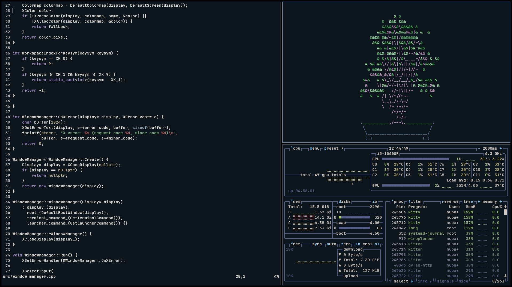
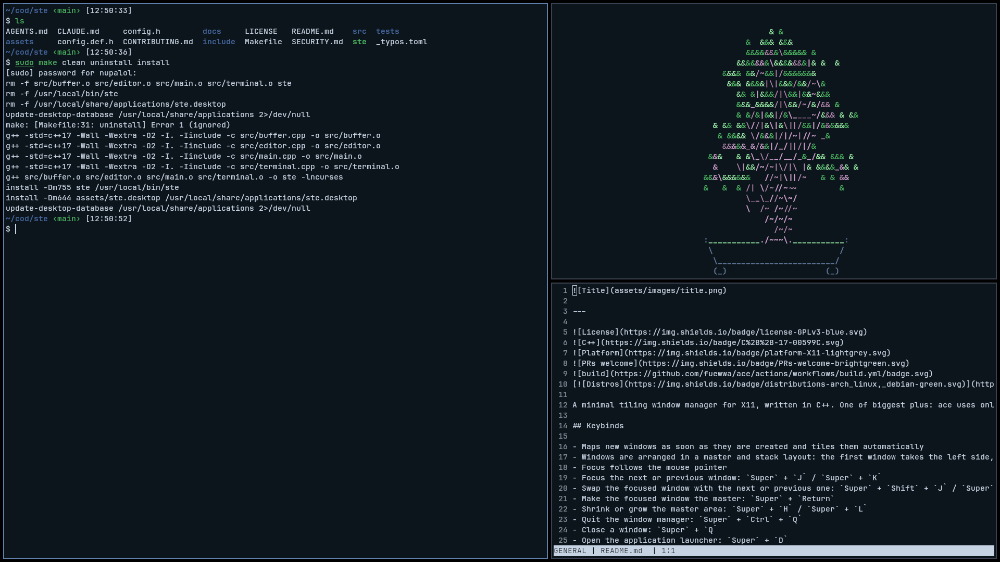
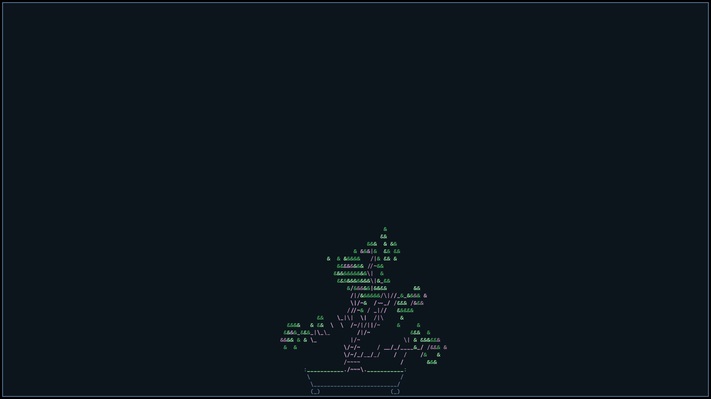

---


[](https://shields.io/)

A minimal tiling window manager for X11, written in C++. One of biggest plus: ace uses only ~5 RAM megabytes

## Default keybinds

Every keybind can be changed in the config file, see [Configuration](#configuration).

- Maps new windows as soon as they are created and tiles them automatically
- Windows are arranged in a master and stack layout: the first window takes the left side, the rest are stacked on the right
- Focus follows the mouse pointer
- Focus the next or previous window: `Super` + `J` / `Super` + `K`
- Swap the focused window with the next or previous one: `Super` + `Shift` + `J` / `Super` + `Shift` + `K`
- Make the focused window the master: `Super` + `Return`
- Shrink or grow the master area: `Super` + `H` / `Super` + `L`
- Quit the window manager: `Super` + `Ctrl` + `Q`
- Close a window: `Super` + `Q`
- Open the application launcher: `Super` + `D`
- Open a terminal: `Super` + `Space`
- Switch workspace: `Super` + `0`-`9`
- Move the focused window to a workspace: `Super` + `Shift` + `0`-`9`
- Make fullscreen: `Super` + `F`
- Reload the config: `Super` + `R`

## System-wide installation
 
If you want to select `ace` as a session from your login manager
(LightDM, GDM, SDDM, etc.), use the commands in Makefile.
 
`make install` copies the `ace` binary to `/usr/bin` and
`assets/ace.desktop` to `/usr/share/xsessions`, so it shows up in the
session picker on the login screen:
 
```
sudo make clean install
```
 
`make uninstall` removes both of these:
 
```
sudo make uninstall
```
 
Both commands require root, since they write to `/usr/bin` and
`/usr/share/xsessions`.

## Configuration

On first run, ace creates a config file at `~/.config/ace/config` (if it
doesn't already exist) and fills it with the defaults. Keybinds are
defined with `bind` lines:

```
mod = Super

bind = mod+Space exec kitty
bind = mod+D exec rofi -show drun
bind = mod+Q close
bind = mod+1..9 workspace
bind = mod+Shift+1..9 move_to_workspace
```

- `mod` is the main modifier, written once and reused as `mod` in every bind. It can be `Super`, `Alt`, `Ctrl`, `Shift`, or a combination such as `Super+Alt`
- A bind is `<modifiers>+<key> <action> [argument]`. Key names are the usual X11 keysym names (`Space`, `Return`, `Tab`, `F1`, `comma`, ...)
- `1..9` is a key range for workspace actions: each key switches to or moves the window to the workspace with the same number. `0` is workspace 10
- Invalid lines are skipped and reported on stderr
- If the config has no `bind` lines at all, the defaults are used

Available actions:

- `exec <command>`: run a program
- `close`: close the focused window
- `quit`: quit ace
- `fullscreen`: toggle fullscreen for the focused window
- `focus_next`, `focus_prev`: move focus through the windows
- `swap_next`, `swap_prev`: swap the focused window with its neighbour
- `promote`: make the focused window the master
- `master_shrink`, `master_grow`: resize the master area
- `workspace <1-10>`: switch workspace
- `move_to_workspace <1-10>`: move the focused window to a workspace
- `reload`: reload the config without restarting ace

ace itself doesn't launch anything on its own. The defaults rely on
external programs:

- a terminal emulator, [kitty](https://github.com/kovidgoyal/kitty)
- an application launcher, [rofi](https://github.com/davatorium/rofi)

Change `kitty` in the `mod+Space` line to any terminal emulator installed on
your system (e.g. `xterm`, `alacritty`, `foot`).

## Dependencies

- g++ with C++17 support
- libX11 (headers and library)

On Arch Linux:

```
sudo pacman -S libx11 xorg-server-xephyr
```

On Debian based:

```
sudo apt install libx11-dev xserver-xephyr
```

On Alpine:

```
sudo apk add libx11 xorg-server-xephyr
```

## Building

```
make
```

The `ace` binary will be produced in the project root. You can write `make help` to see Makefile command list

## Running

For testing without leaving your current session, use Xephyr:

```
Xephyr :1 -screen 1280x800 &
DISPLAY=:1 ./ace
```
Alternatively, just run:

```
make run
```

This checks that Xephyr is installed, builds `ace` if needed, then starts
Xephyr and launches `ace` on `DISPLAY=:1`.

Then, in that same `DISPLAY=:1`, you can launch any X11 application, e.g.:
```
DISPLAY=:1 xterm
```
To use `ace` as your main window manager, add this to `~/.xinitrc`:
```
exec /path/to/ace
```
and start your session with `startx`. Or select in your greeter

## Screenshots





## License

This project is licensed under the GNU General Public License v3.0 (GPLv3).
See the `LICENSE` file for the full text.
